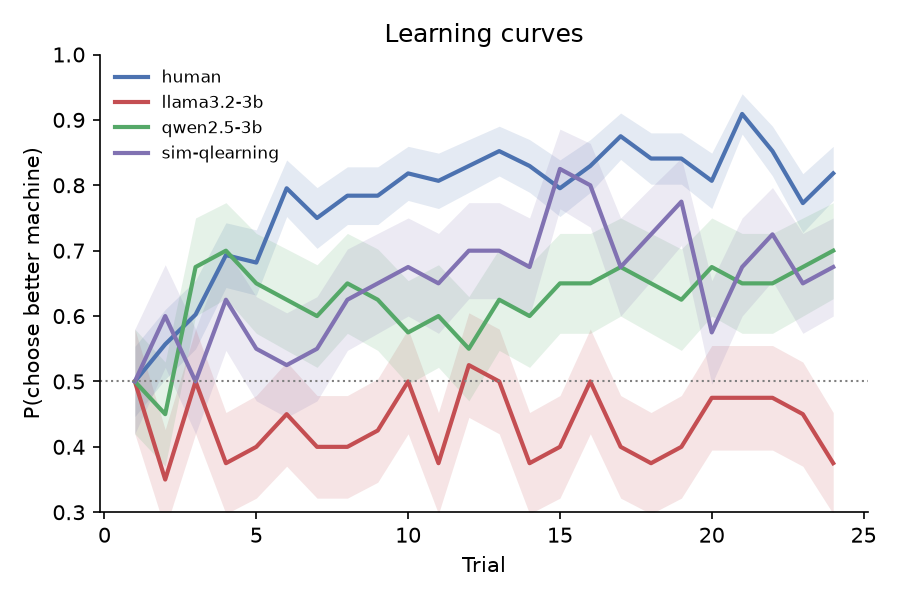
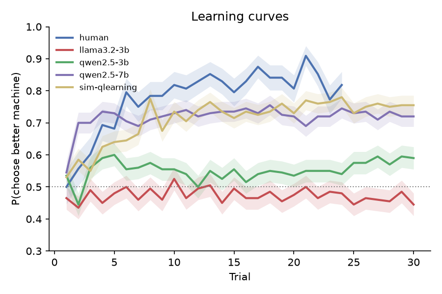
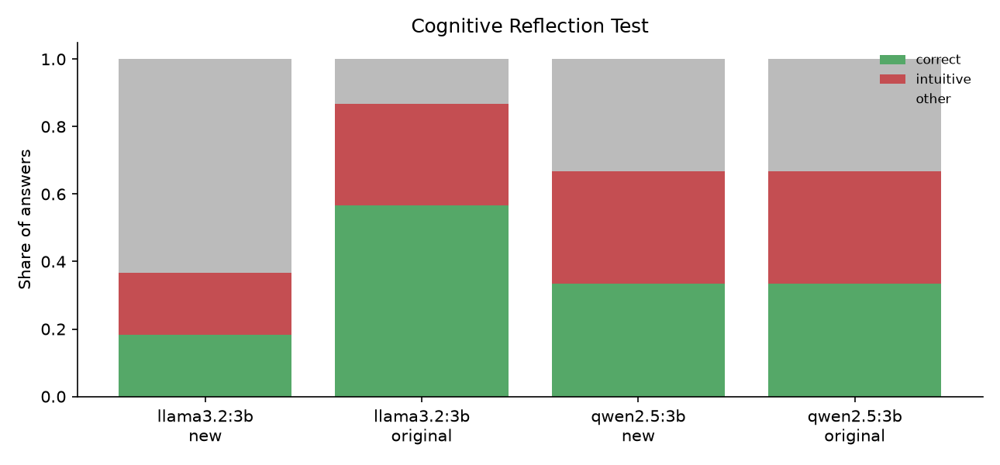
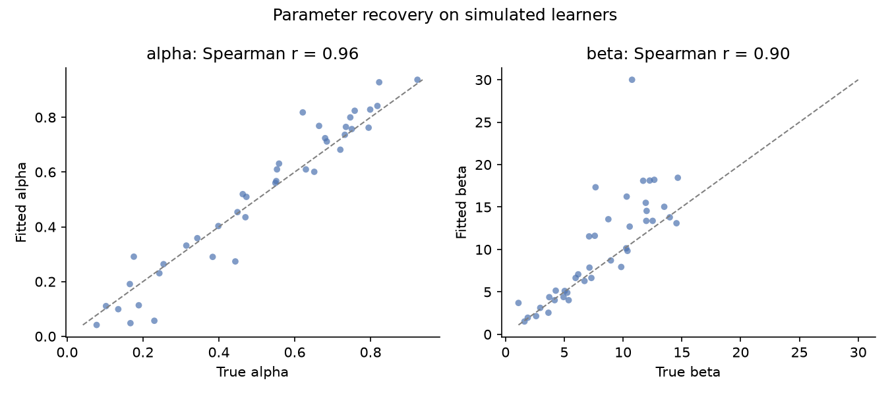

# Do Language Models Learn and Reason Like People?

 [](https://doi.org/10.5281/zenodo.24023655)

**Preprint:** Muzamil (2026). *Reward learning, perseveration and reflection in small language models: a cognitive-modelling comparison with humans.* Zenodo. https://doi.org/10.5281/zenodo.24023655

This project treats large language models (LLMs) as **participants in psychology experiments**. They do the same tasks that cognitive psychologists give to people, and their behaviour is analysed with the same computational models.

Two tasks:

| Task | What it measures | Analysis |
|---|---|---|
| **Two-armed bandit** | Learning from rewards, and the balance between exploring and exploiting | Q-learning model fitted by maximum likelihood; model comparison with BIC |
| **Cognitive Reflection Test (CRT)** | Fast intuitive answers versus careful reasoning | Correct vs "intuitive" (tempting wrong) answers, on original and new items |

**Questions:**
1. Do LLMs learn which slot machine is better, and how does their learning rate (α) and randomness (β) compare with humans?
2. Do LLMs make the same intuitive errors as people on the CRT, or only solve the famous items because they have seen them before?

## Results

Bandit: 20 LLM participants per model (300 choices each, **0 of 6,000** choices needed a random fallback), 44 human participants (48 choices each), and 20 simulated Q-learners as a reference. Medians per group; numbers from `results/analysis.json` and `results/fits.csv`.

| Group | Accuracy | Switch rate | Win-stay | Lose-shift | Best model (BIC, count) | Stickiness κ |
|---|---|---|---|---|---|---|
| Humans (Lefebvre et al., 2017) | **0.82** | 0.21 | 0.90 | 0.33 | Q-learning 26, Q+persev. 9, random 8, WSLS 1 | 0.38 |
| llama3.2:3b | 0.50 | 0.37 | 0.64 | 0.33 | Q+persev. 12, random 8 | 0.55 |
| qwen2.5:3b | 0.53 | 0.07 | 0.93 | 0.08 | Q+persev. 20 | 2.42 |
| qwen2.5:7b | 0.72 | 0.08 | 0.98 | 0.15 | Q+persev. 20 | 2.17 |
| Simulated Q-learner | 0.71 | 0.25 | 0.89 | 0.44 | Q-learning 20 | 0.04 |

**Same task as the humans.** To rule out task differences, both LLMs also played the human design (`configs/human_design.yaml`): 20 participants × 2 games × 24 trials, with machines paying 75% vs 25% (0 of 960 fallbacks per model). Results are in `results/human_design/`.

| Group | Accuracy (median) | Switch rate | Best model (count) | κ |
|---|---|---|---|---|
| Humans | 0.82 | 0.21 | Q-learning 26 of 44 | 0.38 |
| llama3.2:3b | 0.50 | 0.35 | random 14, Q+persev. 5, Q-learning 1 | 0.62 |
| qwen2.5:3b | 0.58 | 0.09 | Q-learning 10, Q+persev. 10 | 1.61 |
| qwen2.5:7b | **0.90** | 0.11 | Q+persev. 13, Q-learning 7 | 1.69 |



llama3.2 still does not learn (accuracy vs humans: Mann-Whitney U = 803, p < 10⁻⁶). With the easier 75/25 gap, qwen2.5 splits in two: 9 of 20 participants reach 75–100% correct, 3 lock onto the *worse* machine (about 2% correct), and the rest stay near chance. Its median accuracy is lower than the humans', but the difference is not significant (U = 517, p = 0.27). It is still far stickier than humans (switch rate U = 683, p < 0.001; κ U = 242.5, p = 0.004).

Cognitive Reflection Test (each item asked 10 times):

| Group | Original items correct (of 3) | New items: correct | New items: intuitive |
|---|---|---|---|
| Humans | 1.24 (Frederick, 2005) | — | — |
| llama3.2:3b | 1.70 | 18% | 18% |
| qwen2.5:3b | 1.00 | 33% | 33% |
| qwen2.5:7b | 2.00 | 97% | 3% |





**Model size (qwen2.5:7b).** The 7B model learns: 72% correct on the main design and a median of 90% on the human design (humans 82%, U = 557, p = 0.09). It is just as sticky as the 3B model, though (κ ≈ 2 vs 0.4 for humans, p ≤ 0.003; perseveration is still its best model). Scale adds reward learning without removing the habit. On the CRT it solves 97% of new items, yet answers the famous bat-and-ball problem with the intuitive "10 cents" on every sample.

**Why qwen2.5:3b scores exactly 33/33/33 on new CRT items.** Its answers are identical across seeds on 8 of 9 items, so 60 answers reduce to 6 item outcomes (2 correct, 2 intuitive, 2 other). It also answers "50" to every cost item, so its one correct cost item (answer 50) is a coincidence.

**What I found:** Humans learn which machine is better within about 5 trials, and their choices are best explained by Q-learning. Neither 3B model learns: llama3.2 stays at chance, and qwen2.5 is only slightly above it. Neither is best described by reward learning. Instead, both are best described by *perseveration*: they repeat their previous choice whatever the outcome. qwen2.5 does this strongly (it switches on only 7% of trials, κ = 2.4 vs 0.4 for humans, Mann-Whitney p < 0.001), and llama3.2 does it weakly while otherwise choosing at random. On the CRT, llama3.2 beats the human average on the three famous items but solves only 18% of new items with the same structure, which fits recall from training data rather than reasoning. qwen2.5 gives the same kind of answer on every sample of each item, even at temperature 0.7.

## Method

### Two-armed bandit
- Each participant plays **10 games × 30 trials**. In each game the two machines pay 1 point with hidden probabilities (between 0.1 and 0.9, at least 0.2 apart).
- The LLM sees the full history of the current game as text and answers with a letter. The machines are called **F** and **J** (as in Binz & Schulz, 2023), and the letters are **randomly swapped between games**, so a model that just prefers one letter cannot look like a good learner.
- Each LLM "participant" is the same model with a different random seed, at temperature 1.0. Unparseable answers are retried up to 3 times; the rare remaining ones become random choices and are counted.

**Models** (fitted per participant, 10 optimizer restarts):
- **Q-learning (Rescorla-Wagner + softmax).** Values are updated by `Q ← Q + α (reward − Q)`; choices follow `P ∝ exp(β · Q)`.
- **Q-learning with perseveration.** As above, plus a bonus κ for repeating the previous choice whatever the reward: `P ∝ exp(β · Q + κ · [same as last choice])`. κ > 0 means sticky, κ < 0 means alternating.
- **Win-stay lose-shift** with noise ε.
- **Random** baseline.

The best model is chosen by BIC. α and β are only interpreted for participants whose behaviour is best explained by Q-learning. `cogllm analyze` follows this rule: its α and β medians and tests use only those participants, and κ uses everyone. No LLM participant is best fit by plain Q-learning, so the LLMs have no α or β to compare.

**Parameter recovery.** Before trusting fitted parameters, I simulated 40 learners with known α and β, fitted them, and compared (`cogllm recovery`). With the original plan of 80 trials, β was not reliably recovered (Spearman r ≈ 0.6). With 300 trials, α is recovered with r ≈ 0.95 and β with r ≈ 0.8–0.9, so 300 trials is the default.



### Cognitive Reflection Test
- The 3 original items (Frederick, 2005) plus **6 new items** with the same structure but new numbers and stories, written for this project.
- Each item is asked 10 times (temperature 0.7). Each answer is scored as **correct**, **intuitive** (the tempting wrong answer, e.g. "10 cents" for the bat and ball) or **other**.
- If a model solves the originals but not the new items, it is probably recalling them from training data rather than reasoning.

### Human data
Human bandit data comes from **Psych-101** (Binz et al., 2025), a collection of psychology experiments with trial-by-trial human choices. `cogllm psych101-peek` lists the bandit-like experiments in it. The closest match to this task is **Lefebvre et al. (2017), experiment 1**: 44 people visit four "casinos", 24 times each and interleaved, and each casino has two machines that pay 0 or 0.5 points. Pooled over all participants, the payout rates are 25/25%, 75/25%, 25/75% and 75/75%, so only casinos 2 and 3 have a better machine. `cogllm psych101-convert` keeps those two as two games of 24 trials (0.5 points → reward 1) and writes `results/bandit_human.csv` in this project's common format (`participant, game, trial, choice, reward, best_arm`). Any human dataset in that format can be compared.

## Quick start

1. **Install Ollama** (free, runs models on your computer) from <https://ollama.com>, open it, and download a small model:
   ```bash
   ollama pull llama3.2:3b
   ```
2. **Install this project** (Python 3.10–3.12):
   ```bash
   git clone https://github.com/Muzz698/llm-cognitive-subjects.git
   cd llm-cognitive-subjects
   conda create -n cogllm python=3.12 -y
   conda activate cogllm
   pip install -e ".[dev,human]"
   pytest
   ```
3. **Run:**
   ```bash
   cogllm recovery                                    # check the fitting works (2 min)
   cogllm --config configs/quick.yaml bandit --model llama3.2:3b   # short test run
   cogllm bandit --model llama3.2:3b                  # full run: 6,000 choices
   cogllm crt --model llama3.2:3b
   cogllm simulate --agent qlearning                  # a reference learner
   cogllm analyze results/bandit_llama3.2-3b.csv results/bandit_sim-qlearning.csv --reference sim-qlearning
   cogllm psych101-peek                               # look at the human data format
   cogllm psych101-convert                            # human data -> results/bandit_human.csv
   cogllm analyze results/bandit_human.csv results/bandit_llama3.2-3b.csv \
       results/bandit_qwen2.5-3b.csv results/bandit_sim-qlearning.csv --reference human
   ```

A full bandit run makes about 6,000 model calls. With a 3B model on a recent laptop, expect roughly 20–60 minutes per model.

## Repository layout

```
src/cogllm/
  bandit.py    task, playing loop, model-free behaviour measures
  agents.py    LLM agent (prompting, answer parsing), simulated learners
  llm.py       Ollama client
  models.py    Q-learning (with and without perseveration), WSLS and random models; fitting; BIC; parameter recovery
  crt.py       CRT items, answer scoring, human reference
  psych101.py  inspect the Psych-101 human dataset; convert Lefebvre et al. (2017)
  plots.py     figures
  cli.py       the `cogllm` command
tests/         24 tests, no LLM or internet needed (LLMs are replaced by fake clients)
docs/REPORT.md short write-up of the study
paper/         6-page preprint (paper.md -> build.sh -> paper.pdf)
```

## Limitations

- Small open models (1–8B parameters) only; results may not hold for larger models.
- The LLM sees the whole history as text, whereas humans must remember it. The models may therefore have an advantage, or a disadvantage if long histories confuse them.
- β is overestimated for very deterministic learners (true β above about 10), as the recovery plot shows; compare β between groups by rank, not by exact value.
- The CRT human reference is a published average, not trial-level data.
- **Task differences.** The main LLM runs (10 × 30 trials, random probabilities) are harder than the human task (2 × 24 trials, 75% vs 25%), so the LLMs were also run on the human design (see Results). One difference remains: human casinos were interleaved, so a human's "previous choice" in a casino may be several trials back, while the LLMs played each game in one block.
- **Human parameters are less reliable.** With 48 trials, parameter recovery gives Spearman r ≈ 0.6 for α and 0.7 for β (vs 0.96 and 0.90 at 300 trials). Compare humans on the model-free measures and best-model counts rather than on individual α or β.
- κ recovers well: Spearman r = 0.98 at 300 trials and 0.91 at the human 48 trials (`cogllm recovery --persev`), so stickiness can be compared between humans and LLMs.

## References

- Binz, M., & Schulz, E. (2023). Using cognitive psychology to understand GPT-3. *PNAS*, 120(6).
- Binz, M., et al. (2025). A foundation model to predict and capture human cognition. *Nature*. (Psych-101 dataset)
- Frederick, S. (2005). Cognitive reflection and decision making. *Journal of Economic Perspectives*, 19(4).
- Sutton, R. S., & Barto, A. G. (2018). *Reinforcement Learning: An Introduction* (2nd ed.).
- Wilson, R. C., & Collins, A. G. E. (2019). Ten simple rules for the computational modeling of behavioral data. *eLife*, 8.

## How to cite

```
Muzamil (2026). Reward learning, perseveration and reflection in small language models:
a cognitive-modelling comparison with humans [Preprint]. Zenodo.
https://doi.org/10.5281/zenodo.24023655
```

## License

MIT
