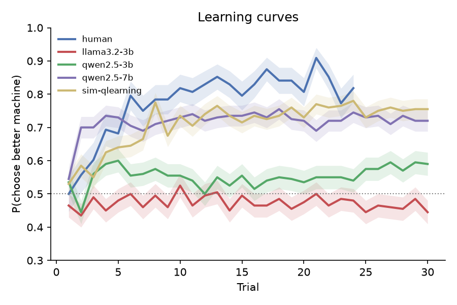
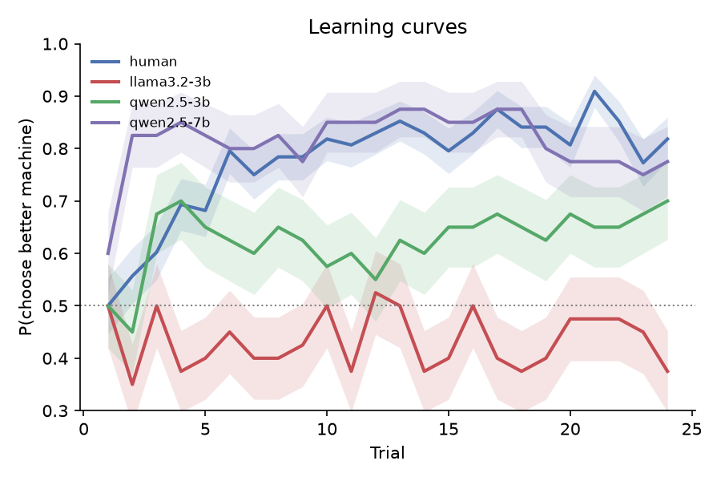
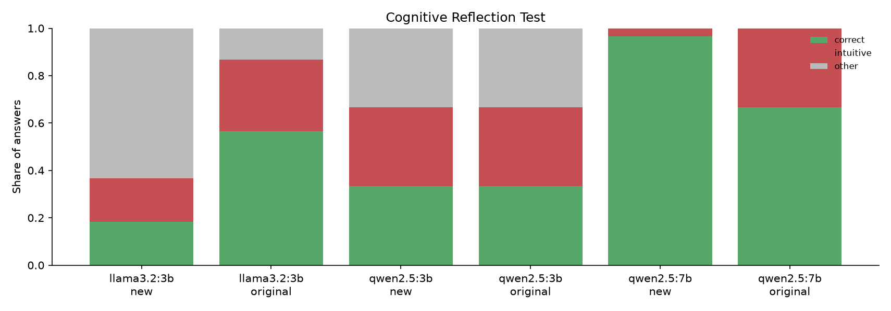

# Do language models learn and reason like people? A cognitive-modelling comparison

**Author:** Muzamil · **Code:** github.com/Muzz698/llm-cognitive-subjects

## 1. Question

Cognitive psychology has well-tested tasks and computational models for describing how people learn and reason. Binz and Schulz (2023) argued that the same tools can be used to study large language models: treat the model as a participant, give it the task, and fit the same models to its behaviour. Doing so tests whether a model behaves like a person, not just whether it gets the right answer.

This study asks two questions about small open models (3 billion parameters) that run on a laptop:

1. **Learning from reward.** In a two-armed bandit, do LLMs learn which machine pays more? Is their behaviour described by the same reinforcement-learning model as human behaviour, and how do the parameters compare?
2. **Reflection vs intuition.** On the Cognitive Reflection Test (CRT), do LLMs make the same intuitive errors as people? Do they solve the famous items only because those items appear in their training data?

I expected the models to learn the bandit, but to explore less than humans, and to solve the original CRT items more often than new items with the same structure.

## 2. Methods

### 2.1 Participants

- **LLMs:** llama3.2:3b and qwen2.5:3b, run locally through Ollama. Each model contributes 20 "participants", which are the same model with different random seeds. Bandit temperature was 1.0 and CRT temperature 0.7. A third model, qwen3:4b, was dropped. The standard version always writes out its reasoning before answering. The instruct version also explained itself on 96 of 240 trials in a pilot, which exceeded the 5-token answer limit.
- **Humans:** 44 participants from Lefebvre et al. (2017), experiment 1, taken from the Psych-101 collection (Binz et al., 2025).
- **Reference learner:** 20 simulated Q-learners, to show what a reward-learning agent looks like under the same analysis.

### 2.2 Two-armed bandit

**LLMs.** Each participant played 10 games × 30 trials. In each game, two machines paid 1 point with hidden probabilities drawn between 0.1 and 0.9, at least 0.2 apart. The prompt described a casino with Machines F and J, then listed the full history of the current game ("Round t: you played Machine F and won 1 point."), and asked for one letter. The letters were randomly swapped between games, so a model with a preference for one letter cannot look like a learner. Unparseable answers were retried up to 3 times and then replaced by a random choice. Neither model needed this: **0 of 6,000** choices were fallbacks for each.

**Humans.** In Lefebvre et al. (2017), participants visit four casinos, 24 times each and interleaved, and each casino has two machines that pay 0 or 0.5 points. Pooled across participants, the payout rates are 25/25%, 75/25%, 25/75% and 75/75%. Only the two asymmetric casinos have a better machine, so only those were kept, as 2 games × 24 trials (2,112 choices in total). A payout of 0.5 was coded as reward 1.

### 2.3 Cognitive models

Four models were fitted to each participant by maximum likelihood, using L-BFGS-B with 10 random restarts.

- **Q-learning:** after each choice c with reward r, `Q_c ← Q_c + α (r − Q_c)`, starting from Q = 0.5. Choices follow a softmax, `P(c) ∝ exp(β Q_c)`. α is the learning rate and β the inverse temperature (low β means more random choices).
- **Q-learning with perseveration:** `P(c) ∝ exp(β Q_c + κ · 1[c = previous choice])`. κ > 0 is a tendency to repeat the last choice regardless of reward. I added this model after the first analysis showed that qwen2.5 almost never switched, which none of the other models could capture.
- **Win-stay lose-shift**, with a noise parameter ε.
- **Random**, which chooses each machine with probability 0.5.

Models were compared per participant with BIC.

**Parameter recovery.** I simulated 40 Q-learners with known α and β, then fitted them. With the LLM design (300 trials), recovery is good: Spearman r = 0.96 for α and 0.90 for β. With the human design (48 trials), recovery is weak: r = 0.59 for α and 0.69 for β. So human α and β are compared mainly through model-free measures and best-model counts. For the perseveration model (κ drawn from −2 to 4), κ recovers well at both designs: r = 0.98 at 300 trials and 0.91 at 48 trials.

### 2.4 Cognitive Reflection Test

Nine items: the 3 originals (Frederick, 2005) and 6 new items written for this project. Each new item has the same structure as one original but new numbers and a new story (two "costs X more" items, two "N machines make N things" items and two "doubling" items). Each item was asked 10 times. Each answer was scored as correct, intuitive (the tempting wrong answer, e.g. 10 cents for the bat and ball) or other. The human reference is the published mean of 1.24 of 3 correct (Frederick, 2005).

## 3. Results

### 3.1 Bandit

| Group | Accuracy | Switch rate | Win-stay | Lose-shift | Best model (count) | κ |
|---|---|---|---|---|---|---|
| Humans | 0.82 | 0.21 | 0.90 | 0.33 | Q-learning 26, Q+persev. 9, random 8, WSLS 1 | 0.38 |
| llama3.2:3b | 0.50 | 0.37 | 0.64 | 0.33 | Q+persev. 12, random 8 | 0.55 |
| qwen2.5:3b | 0.53 | 0.07 | 0.93 | 0.08 | Q+persev. 20 | 2.42 |
| Simulated Q-learner | 0.71 | 0.25 | 0.89 | 0.44 | Q-learning 20 | 0.04 |

*Values are medians per participant. Accuracy is the share of trials on which the better machine was chosen.*

**Humans learn.** They reach about 80% correct within 6 trials. Most (26 of 44) are best fitted by plain Q-learning, with median α = 0.18 and β = 9.4 among those 26.

**Neither LLM learns.** Both are much less accurate than humans (Mann-Whitney: llama U = 826, p < 10⁻⁷; qwen U = 761, p < 10⁻⁵). Neither model is best fitted by Q-learning for a single participant.

- **llama3.2:3b** stays at chance for all 30 trials. For its 12 participants best fit by perseveration, the fitted α and β are both about 0, so reward has no influence. Its only consistent pattern is a mild tendency to repeat the previous choice. The other 8 are best described as random. Compared with humans, it switches more (U = 203, p < 0.001) and stays less after a win (U = 762, p < 10⁻⁵).
- **qwen2.5:3b** is extremely sticky. It switches on 7% of trials, against 21% for humans (U = 691, p < 0.001), and almost never shifts after a loss (8% vs 33%, U = 811, p < 10⁻⁷). Its κ is much larger than the human κ (U = 132, p < 10⁻⁵), and the perseveration model wins for all 20 participants. The learning curve shows a small rise in the first few trials and then a flat line around 55%: it settles on a machine early and keeps it.

The simulated Q-learner comes out as plain Q-learning with κ ≈ 0, which shows that the perseveration model does not win just because it has an extra parameter.

**Same task as the humans.** The LLM task above is harder than the human one, so both models also played the human design: 20 participants × 2 games × 24 trials, with machines paying 75% vs 25%, and 0 of 960 fallbacks per model.

| Group | Accuracy (median) | Switch rate | Best model (count) | κ |
|---|---|---|---|---|
| Humans | 0.82 | 0.21 | Q-learning 26 of 44 | 0.38 |
| llama3.2:3b | 0.50 | 0.35 | random 14, Q+persev. 5, Q-learning 1 | 0.62 |
| qwen2.5:3b | 0.58 | 0.09 | Q-learning 10, Q+persev. 10 | 1.61 |

llama3.2 still does not learn (accuracy vs humans: U = 803, p < 10⁻⁶), and random is its best model for 14 of 20 participants. qwen2.5 behaves differently on this easier task. Its participants split into three kinds: 9 of 20 reach 75–100% correct, 3 lock onto the worse machine (about 2% correct), and 8 stay near chance. As a result, its accuracy does not differ significantly from the humans' (U = 517, p = 0.27), and half its participants are best fit by plain Q-learning. It is still far stickier than humans (switch rate: U = 683, p < 0.001; κ: U = 242.5, p = 0.004). Whatever it settles on early, right or wrong, it keeps.

### 3.2 CRT

| Group | Originals correct (of 3) | New: correct | New: intuitive | New: other |
|---|---|---|---|---|
| Humans | 1.24 | — | — | — |
| llama3.2:3b | 1.70 | 18% | 18% | 63% |
| qwen2.5:3b | 1.00 | 33% | 33% | 33% |

llama3.2 does better than the human average on the original items but solves only 18% of the new ones. Most of its wrong answers on new items are not the intuitive error. They are other numbers, often far off (e.g. 791 cents for a drink in a $13 order, where the answer is 50). qwen2.5 gave the same kind of answer on all 10 samples of every item, despite temperature 0.7. It made the intuitive error on all three doubling items (e.g. 24 days for the lily pads), solved two of the three "N machines" items and one of the three cost items, and on bat-and-ball answered 20 or 50, which is neither correct nor intuitive. The even 33/33/33 split is an artefact: answers were identical across seeds, so the 60 new-item answers reduce to 6 item outcomes (2/2/2). qwen2.5 also answered "50" on all three cost items, so its one correct cost item (pizza-and-drink, answer 50) is a coincidence of a default answer. Excluding it, it solved 1 of 6 new items.

### 3.3 Update: a larger model (qwen2.5:7b)

| Design | Accuracy | Switch rate | Best model | κ |
|---|---|---|---|---|
| Main | 0.72 (humans 0.82, p = .022) | 0.08 | Q+persev. 20 | 2.17 |
| Human design | 0.90 (humans 0.82, p = .09) | 0.11 | Q+persev. 13, Q-learning 7 | 1.69 |

The 7B model learns which machine pays more, but it is as sticky as the 3B model (κ vs humans p < 10⁻⁵ main, p = .003 human design). On the CRT it solves 97% of new items and 2 of 3 originals, but gives the intuitive "10 cents" on bat-and-ball on all 10 samples: the reverse of llama3.2's memorisation pattern.

## 4. Discussion

**Bandit.** Small LLMs given the full history as text do not behave like reward learners. Humans in a similar task show the expected pattern: fast learning that Q-learning describes well. The two models fail in different ways, and the matched-design runs show that the failure is not just because the LLM task was harder. llama3.2 does not use the reward information at all. qwen2.5 commits to an option and sticks with it, which looks more like a strong habit than like exploitation of a learned value. When the better machine is easy to spot (75% vs 25%), this habit sometimes locks qwen2.5 onto the right machine and sometimes onto the wrong one. Humans also exploit, but they still switch away from a bad option. Binz and Schulz (2023) found that GPT-3 performed well on two-armed bandits, so learning from in-context reward history seems to need more capacity than 3B models have. The perseveration model was needed to describe the LLMs. Without it, the first analysis labelled qwen2.5 as "random", which hides how structured its behaviour is.

**CRT.** The gap between llama3.2's original-item and new-item performance fits memorisation of the famous items rather than reflective reasoning. On new items it rarely gives either the reflective or the intuitive answer, so it is not "intuitive like people". It is mostly wrong in ways people seldom are. qwen2.5 matches neither pattern clearly. Its near-deterministic answers suggest that sampling at temperature 0.7 adds little variety for short numeric answers.

**Model size.** Both models are 3B, so no conclusion can be drawn about size. The differences between them are qualitative (random vs sticky), which suggests that training details matter as much as parameter count at this scale.

## 5. Limitations and next steps

- **Task versions.** The main LLM task was harder than the human one, so both models were also run on the human design (Section 3.1), and the conclusions hold. One difference remains: humans visited their casinos interleaved, while the LLMs played each game in one block.
- **Human parameters are unreliable** at 48 trials (recovery r ≈ 0.6–0.7), so I compared humans with the LLMs on model-free measures and best-model counts. κ is reliable at both designs (r ≥ 0.91).
- **History as text.** The LLMs see the whole history, while humans must remember it. Even so, the models do worse.
- **Only small models**: two at 3B and one at 7B. The CRT human reference is a published mean, not trial-level data.
- **Next steps:** interleave the LLM games to match the human design fully. Add larger models (7–8B) to test whether learning appears with size. Try a prompt that summarises each machine's payouts, to separate a reasoning failure from a long-context failure. Apply the same models to the other bandit experiments in Psych-101.

## References

- Binz, M., & Schulz, E. (2023). Using cognitive psychology to understand GPT-3. *PNAS*, 120(6).
- Binz, M., et al. (2025). A foundation model to predict and capture human cognition. *Nature*. (Psych-101 dataset)
- Frederick, S. (2005). Cognitive reflection and decision making. *Journal of Economic Perspectives*, 19(4).
- Lefebvre, G., Lebreton, M., Meyniel, F., Bourgeois-Gironde, S., & Palminteri, S. (2017). Behavioural and neural characterization of optimistic reinforcement learning. *Nature Human Behaviour*, 1, 0067.
- Sutton, R. S., & Barto, A. G. (2018). *Reinforcement Learning: An Introduction* (2nd ed.).
- Wilson, R. C., & Collins, A. G. E. (2019). Ten simple rules for the computational modeling of behavioral data. *eLife*, 8.
