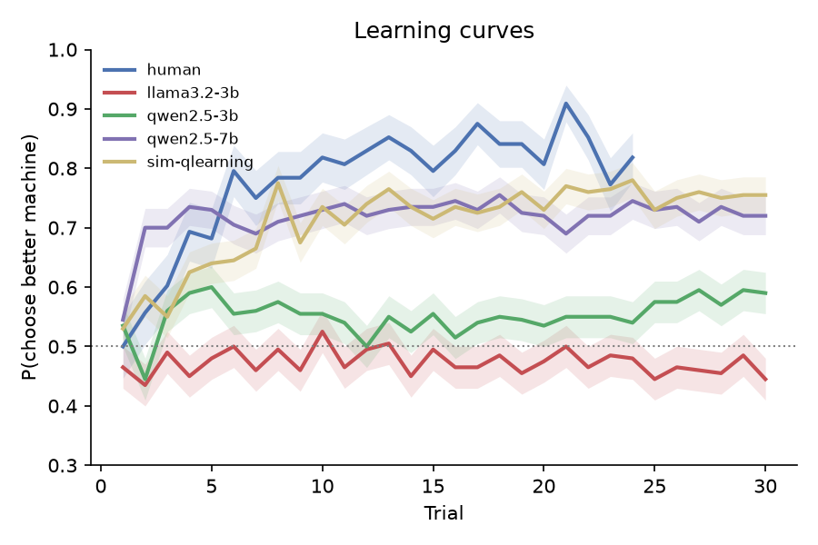
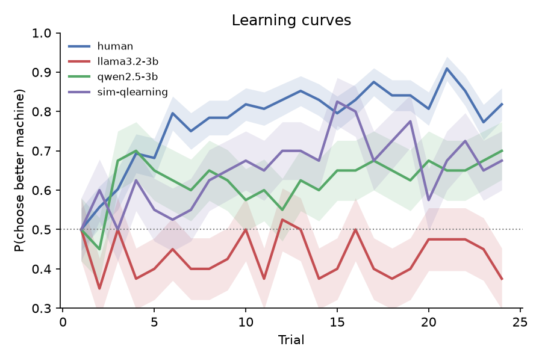
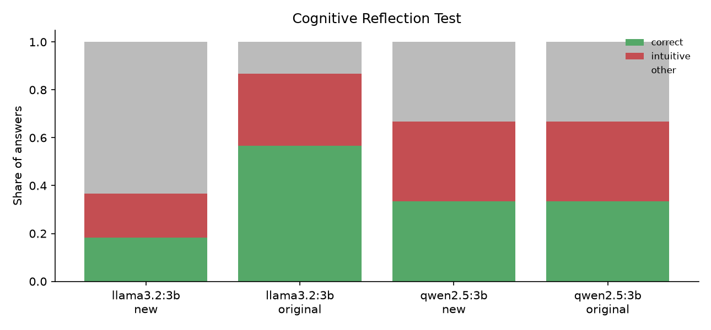

# 1. Introduction

Cognitive psychology has a long tradition of explaining behaviour with formal models that are fitted to individual participants. Binz and Schulz (2023) proposed applying the same tools to large language models (LLMs). The model is treated as a participant, given a standard task, and then analysed with the models used for people. This approach asks *how* a model behaves, not only whether its answers are correct. Since then, LLMs have been tested on batteries of cognitive tasks (Coda-Forno et al., 2024), on reasoning biases such as those in the Cognitive Reflection Test (Hagendorff et al., 2023), and on reinforcement-learning tasks in which their in-context learning can be described by asymmetric belief updating (Schubert et al., 2024).

Most of this work studies large commercial models. Small open models (a few billion parameters) are widely used, cheap to run and fully reproducible, but much less is known about their cognitive profile. They are also a useful test case. If behaviours such as reward learning appear only at large scale, small models should fail in ways that cognitive models can describe.

This study asks two questions:

1. **Learning from reward.** In a two-armed bandit, do small LLMs learn which option pays more? Is their behaviour captured by the reinforcement-learning model that describes humans, and how do their parameters compare?
2. **Reflection versus intuition.** On the Cognitive Reflection Test (CRT; Frederick, 2005), do LLMs make the same intuitive errors as people? Do they solve the famous items only because those items appear in their training data?

I expected the models to learn the bandit while exploring less than humans, and to solve the original CRT items more often than new items with the same structure.

# 2. Methods

## 2.1 Participants

**LLMs.** I used llama3.2:3b and qwen2.5:3b, both run locally through Ollama. Each model contributed 20 "participants", which were the same model sampled with different random seeds. Sampling temperature was 1.0 in the bandit task and 0.7 in the CRT. Answers were limited to 5 tokens. Unparseable answers were retried up to 3 times and then replaced by a random choice. No choice from either model needed this fallback (0 of 6,000 per model). A third model, qwen3:4b, was excluded after piloting. Its standard version always produces reasoning text before answering, and its instruct version exceeded the answer limit on 96 of 240 pilot trials.

**Humans.** I used 44 participants from experiment 1 of Lefebvre et al. (2017), taken from the Psych-101 collection (Binz et al., 2025).

**Reference learner.** I simulated 20 Q-learners on the LLM task, to show what a genuine reward learner looks like under the same analysis.

## 2.2 Two-armed bandit

**LLM task.** Each participant played 10 games of 30 trials. In each game, two slot machines paid 1 point with hidden probabilities drawn uniformly between 0.1 and 0.9, at least 0.2 apart. Following Binz and Schulz (2023), the prompt described a casino with machines labelled F and J. It then listed the full history of the current game (e.g. "Round 3: you played Machine F and won 1 point.") and asked for a single letter. The assignment of letters to machines was randomised between games, so a preference for one letter could not look like learning.

**Human task.** In Lefebvre et al. (2017), participants visited four casinos 24 times each, interleaved. Each casino had two machines that paid 0 or 0.5 points. Pooled over participants, the payout rates were 25/25%, 75/25%, 25/75% and 75/75%. Only the two asymmetric casinos have a better option, so only those were analysed, as 2 games of 24 trials (2,112 choices in total). A payout of 0.5 was coded as reward 1.

**Matched design.** The LLM task is harder than the human one, so both models also played the human design: 20 participants, 2 games of 24 trials, with machines paying 75% versus 25% (0 of 960 fallbacks per model). Unlike the humans, the LLMs played each game in a single block rather than interleaved.

## 2.3 Cognitive models

I fitted four models to each participant by maximum likelihood (L-BFGS-B, 10 random restarts) and compared them with the Bayesian information criterion (BIC), following Wilson and Collins (2019).

- **Q-learning.** After choosing option *c* and receiving reward *r*, Q~c~ ← Q~c~ + α(*r* − Q~c~), with Q initialised at 0.5. Choices follow a softmax, P(*c*) ∝ exp(β Q~c~). α is the learning rate and β the inverse temperature.
- **Q-learning with perseveration.** P(*c*) ∝ exp(β Q~c~ + κ · 1[*c* = previous choice]). κ > 0 is a tendency to repeat the previous choice regardless of reward (Lau & Glimcher, 2005; Katahira, 2015). I added this model after a first analysis showed that qwen2.5 almost never switched, which none of the other models captured.
- **Win-stay lose-shift (WSLS)**, with a noise parameter ε.
- **Random**, which chooses each option with probability 0.5.

α and β were interpreted only for participants best fitted by Q-learning. κ was compared across all participants. Groups were compared with two-sided Mann-Whitney U tests on per-participant medians. I also report model-free measures: accuracy (the proportion of choices of the better option), switch rate, win-stay and lose-shift.

**Parameter recovery.** I simulated 40 agents with known parameters and refitted them. With the LLM design (300 trials per participant), α and β were well recovered (Spearman *r* = 0.96 and 0.90). With the human design (48 trials), recovery was weak (α: *r* = 0.59; β: *r* = 0.69). Human α and β were therefore not compared directly with the LLMs. κ (drawn from −2 to 4) was well recovered at both designs (*r* = 0.98 at 300 trials, 0.91 at 48 trials), so stickiness can be compared reliably between humans and models.

## 2.4 Cognitive Reflection Test

The test had nine items: the three originals (Frederick, 2005) and six new items written for this study. Each new item shares the structure of one original but uses new numbers and a new story (two "costs X more" items, two "N machines make N things" items and two "doubling" items). Each item was presented 10 times. Each answer was scored as correct, intuitive (the tempting wrong answer, such as 10 cents in the bat-and-ball problem) or other. The human reference is the published mean of 1.24 of 3 correct (Frederick, 2005).

# 3. Results

## 3.1 Bandit: main design

{width=62%}

: Table 1. Bandit behaviour and model fits on the main design (medians per participant). Accuracy is the proportion of choices of the better option.

| Group | Accuracy | Switch | Win-stay | Lose-shift | Best model (count) | κ |
|---|---|---|---|---|---|---|
| Humans (*n* = 44) | 0.82 | 0.21 | 0.90 | 0.33 | Q 26, Q+P 9, random 8, WSLS 1 | 0.38 |
| llama3.2:3b (*n* = 20) | 0.50 | 0.37 | 0.64 | 0.33 | Q+P 12, random 8 | 0.55 |
| qwen2.5:3b (*n* = 20) | 0.53 | 0.07 | 0.93 | 0.08 | Q+P 20 | 2.42 |
| Simulated Q-learner (*n* = 20) | 0.71 | 0.25 | 0.89 | 0.44 | Q 20 | 0.04 |

*Note.* Q = Q-learning; Q+P = Q-learning with perseveration.

Humans learned quickly, reaching about 80% correct within six trials (Figure 1). Most humans (26 of 44) were best fitted by plain Q-learning, with median α = 0.18 and β = 9.4 among those participants.

Neither LLM learned. Both were far less accurate than humans (llama3.2: U = 826, *p* < 10⁻⁷; qwen2.5: U = 761, *p* < 10⁻⁵). No LLM participant was best fitted by plain Q-learning.

**llama3.2** stayed at chance across all 30 trials. For the 12 participants best fitted by the perseveration model, the fitted α and β were both close to zero, so reward had no measurable effect on choice. The remaining 8 participants were best described as random. Compared with humans, llama3.2 switched more often (U = 203, *p* < .001) and stayed less often after a win (U = 762, *p* < 10⁻⁵). Its κ did not differ from the human κ (U = 421, *p* = .79).

**qwen2.5** was extremely sticky. It switched on 7% of trials against 21% for humans (U = 691, *p* < .001), and it almost never shifted after a loss (8% vs 33%; U = 811, *p* < 10⁻⁷). Its κ was about six times the human value (2.42 vs 0.38; U = 132, *p* < 10⁻⁵), and the perseveration model won for all 20 participants. Its learning curve rose slightly in the first trials and then stayed flat at about 55%.

The simulated Q-learners were recovered as plain Q-learners with κ ≈ 0. The perseveration model therefore did not win merely because of its extra parameter.

## 3.2 Bandit: matched human design

{width=62%}

: Table 2. Behaviour on the matched human design (medians per participant).

| Group | Accuracy | Switch rate | Best model (count) | κ |
|---|---|---|---|---|
| Humans (*n* = 44) | 0.82 | 0.21 | Q 26 of 44 | 0.38 |
| llama3.2:3b (*n* = 20) | 0.50 | 0.35 | random 14, Q+P 5, Q 1 | 0.62 |
| qwen2.5:3b (*n* = 20) | 0.58 | 0.09 | Q 10, Q+P 10 | 1.61 |

llama3.2 still did not learn (accuracy vs humans: U = 803, *p* < 10⁻⁶), and random was its best model for 14 of 20 participants. qwen2.5 behaved differently on this easier task. Its participants fell into three groups. Nine of 20 reached 75–100% correct, three locked onto the worse machine (about 2% correct), and eight stayed near chance. Because of this bimodality, its median accuracy did not differ significantly from the human median (U = 517, *p* = .27), and half its participants were best fitted by plain Q-learning. It remained far stickier than humans (switch rate: U = 683, *p* < .001; κ: U = 242.5, *p* = .004). Whatever qwen2.5 settled on early, right or wrong, it kept.

## 3.3 Cognitive Reflection Test

{width=52%}

: Table 3. CRT results. Each item was presented 10 times.

| Group | Originals correct (of 3) | New: correct | New: intuitive | New: other |
|---|---|---|---|---|
| Humans (Frederick, 2005) | 1.24 | — | — | — |
| llama3.2:3b | 1.70 | 18% | 18% | 63% |
| qwen2.5:3b | 1.00 | 33% | 33% | 33% |

llama3.2 exceeded the human average on the original items but solved only 18% of the new ones. Most of its errors on new items were not the intuitive answer. They were other numbers, often far off (for example, 791 cents for an item whose answer is 50). qwen2.5 gave the same kind of answer on all 10 samples of each item, despite the 0.7 temperature. It gave the intuitive answer on all three doubling items, solved two of the three "N machines" items and one of the three cost items, and answered bat-and-ball with a number that was neither correct nor intuitive.

# 4. Discussion

**Small LLMs do not behave like reward learners.** Even with the complete history of outcomes in front of them, neither 3B model used reward to guide its choices in the way humans do. The two models failed in qualitatively different ways. llama3.2 ignored reward and chose close to randomly. qwen2.5 committed to an option and kept it. That looks more like a strong habit than like exploitation of a learned value, because a learner that exploits still abandons an option that keeps losing. The matched-design runs show that these failures are not explained by the harder LLM task. When the better option was easy to find, qwen2.5's habit sometimes locked it onto the right machine and sometimes onto the wrong one. This produced a group median close to the human median but a very different pattern for individual participants.

These results contrast with the good bandit performance of GPT-3 reported by Binz and Schulz (2023), and with the structured in-context learning of larger models (Schubert et al., 2024). Together, they suggest that learning from reward in context needs more capacity or different training than these 3B models have. Both models are the same size but fail in different ways, so training details appear to matter at least as much as parameter count at this scale.

**Perseveration must be modelled.** Without the perseveration model, the first analysis labelled qwen2.5 as "random", which hides the most distinctive structure in its behaviour. Perseveration is a standard component of human and animal choice models (Lau & Glimcher, 2005; Katahira, 2015). These results suggest that it should be a default part of any model set applied to LLMs, because a stickiness term can absorb behaviour that would otherwise be attributed to learning or to noise.

**CRT performance reflects familiarity rather than reflection.** llama3.2's drop from above-human performance on the famous items to 18% on new versions with the same structure fits memorisation of training data. This matches broader evidence that LLM performance depends on how familiar a problem's surface form is (McCoy et al., 2023). Its errors on the new items were mostly neither reflective nor intuitive, so it is not "intuitive like people". It is wrong in ways that people seldom are. qwen2.5's near-deterministic answers suggest that sampling temperature adds little variety to short numeric answers. If so, studies that treat multiple samples from one model as independent participants should check whether the samples really differ.

# 5. Limitations

First, only two models were tested, both at 3B parameters, so the study cannot say how these behaviours change with scale. Second, the human and LLM tasks differ in one remaining respect: humans visited their casinos interleaved, while the LLMs played each game in one block. Third, the LLMs saw the full history as text while humans had to remember it. This should favour the models, yet they still performed worse. A prompt that summarises each option's payouts could separate a failure to reason from reward from a failure to read a long history. Fourth, human α and β were poorly recovered with 48 trials, so humans were compared with the models mainly on model-free measures, best-model counts and κ, which recovered well. Fifth, "participants" from one LLM are samples from a single model, not independent individuals, so the group statistics describe variability in sampling, not between people. Finally, the CRT human reference is a published mean rather than trial-level data, and the six new items have not been normed on human participants.

Future work should test larger models (7–8B and above) to see whether learning from reward emerges with scale, interleave the LLM games to match the human design fully, and apply the same pipeline to the other bandit experiments in Psych-101.

# Data and code availability

All code, prompts, raw choices, fitted parameters and figures are available at https://github.com/Muzz698/llm-cognitive-subjects. The repository includes automated tests, and every result can be reproduced on a laptop with free software.

# Use of AI tools

The analysis code was written with help from an AI coding assistant (Claude, Anthropic), which also helped draft this manuscript. The author designed the study, ran the experiments, checked the results and takes full responsibility for the content.

# References

Binz, M., Akata, E., Bethge, M., et al. (2025). A foundation model to predict and capture human cognition. *Nature*.

Binz, M., & Schulz, E. (2023). Using cognitive psychology to understand GPT-3. *Proceedings of the National Academy of Sciences, 120*(6), e2218523120.

Coda-Forno, J., Binz, M., Wang, J. X., & Schulz, E. (2024). CogBench: A large language model walks into a psychology lab. *Proceedings of the 41st International Conference on Machine Learning*.

Frederick, S. (2005). Cognitive reflection and decision making. *Journal of Economic Perspectives, 19*(4), 25–42.

Hagendorff, T., Fabi, S., & Kosinski, M. (2023). Human-like intuitive behavior and reasoning biases emerged in large language models but disappeared in ChatGPT. *Nature Computational Science, 3*, 833–838.

Katahira, K. (2015). The relation between reinforcement learning parameters and the influence of reinforcement history on choice behavior. *Journal of Mathematical Psychology, 66*, 59–69.

Lau, B., & Glimcher, P. W. (2005). Dynamic response-by-response models of matching behavior in rhesus monkeys. *Journal of the Experimental Analysis of Behavior, 84*(3), 555–579.

Lefebvre, G., Lebreton, M., Meyniel, F., Bourgeois-Gironde, S., & Palminteri, S. (2017). Behavioural and neural characterization of optimistic reinforcement learning. *Nature Human Behaviour, 1*, 0067.

McCoy, R. T., Yao, S., Friedman, D., Hardy, M., & Griffiths, T. L. (2023). Embers of autoregression: Understanding large language models through the problem they are trained to solve. *arXiv:2309.13638*.

Schubert, J. A., Jagadish, A. K., Binz, M., & Schulz, E. (2024). In-context learning agents are asymmetric belief updaters. *Proceedings of the 41st International Conference on Machine Learning*.

Sutton, R. S., & Barto, A. G. (2018). *Reinforcement learning: An introduction* (2nd ed.). MIT Press.

Wilson, R. C., & Collins, A. G. E. (2019). Ten simple rules for the computational modeling of behavioral data. *eLife, 8*, e49547.
